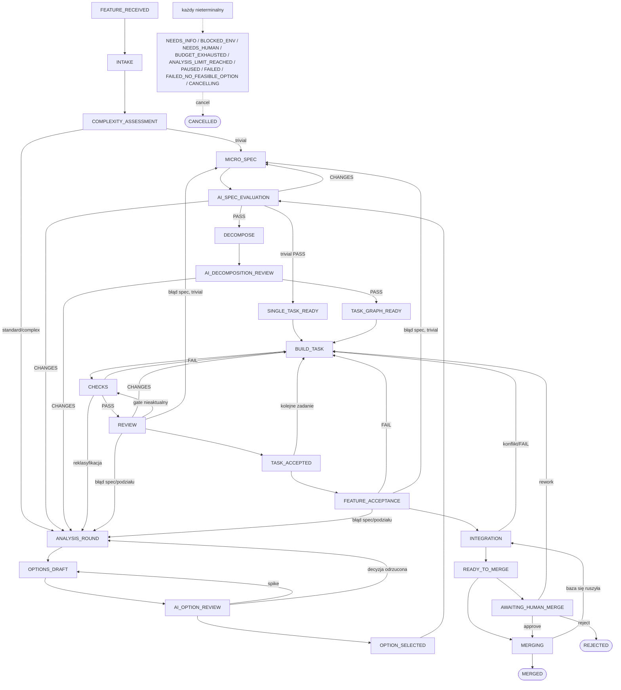

# Architektura Agent Factory (stan zaimplementowany)

Dokument opisuje to, co jest w kodzie `src/agent_factory/`, a nie docelowy blueprint. Odstępstwa od
blueprintu są wymienione na końcu.

## Komponenty i odpowiedzialności

| Komponent | Moduł | Za co odpowiada | Czego nie robi |
|---|---|---|---|
| Controller | `controller.py` (`Controller`, `legal`, `_MAIN`) | legalność przejść, guard na stan docelowy, CAS wersji joba, zdarzenie `state.transition` | nie czyta tekstu agenta; guard czyta tylko podpisane wyniki |
| Orkiestracja | `factory.py` (`Factory`) | wykonanie pracy danego stanu (`_step_<state>`), wywołania agentów, routing błędów, checkpointy, halt/resume, cancel, decyzje człowieka | nie omija guardów; `resume` zapisuje stan bezpośrednio, ale tylko po `legal()` (patrz state-machine.md) |
| Tożsamość i unieważnianie | `identities.py` | `InputIdentity`, `digest` (SHA-256 kanonicznego JSON), `RESULT_DEPENDENCIES`, `stale_fields` | — |
| Evidence store | `evidence.py` (`EvidenceStore`) | artefakty adresowane treścią, wyniki podpisane HMAC-SHA256, cykl życia findings, `current_pass` | nie czyta eksportów z gałęzi joba jako dowodów |
| Trusted runner | `runner.py` (`TrustedRunner`) | uruchomienie komend z `factory/checks/default.yaml` w sandboxie, junit, klasyfikacja `GateVerdict`, `CheckEvidence` | nie ufa deklaracji buildera „testy przeszły” |
| Sandbox | `sandbox.py` | `MacSandbox` (SBPL dla `sandbox-exec`), `BwrapSandbox`, probe przy starcie, scrub env | brak trybu bez sandboxa |
| Policy | `policy.py` | gate na rzeczywistym diffie (protected paths, file_scope, osłabianie testów), ryzyko i powierzchnie (`ui`, `security`), broker skutków ubocznych `authorize_side_effect` | nie obniża ryzyka |
| Scheduler | `scheduler.py` | walidacja DAG, `ready_tasks`, dzierżawy z epoką i fencingiem, globalne sloty `agent_process` | brak priorytetów/agingu; zadania w jobie wykonywane sekwencyjnie |
| Budżet | `budgets.py` | rezerwacja przed każdym płatnym wywołaniem, rozliczenie z `total_cost_usd`, rezerwa na weryfikację, `raise_budget` | agent nie podnosi limitu |
| Licznik analizy | `analysis.py` | wspólny licznik rund (opcje + spec + dekompozycja), brak postępu, `raise_limit` | nie resetuje się po restarcie ani zmianie modelu |
| Decyzje | `decisions.py` | scoring opcji wagami z `selection.yaml`, tie-break, dokładnie jeden wybór, weryfikacja wyboru AI | — |
| Feature | `features.py` | normalizacja wejścia, niezmienny snapshot i rewizje, klasyfikacja ścieżki `trivial/standard/complex` | — |
| Workspace | `workspaces.py` (`WorkspaceManager`) | worktree `factory/<job-id>` w `data_dir/worktrees`, commit kontrolera, diff, kandydat integracji, push warunkowy, cleanup bez `--force` | nie modyfikuje checkoutu użytkownika |
| Outbox | `outbox.py` | zamiar efektu w transakcji, `pending/inflight/confirmed/unknown/failed`, rekonsyliacja `lookup` przed ponowieniem | nie obiecuje exactly-once |
| Recovery | `recovery.py` | `recover_job`: wyniki → git → procesy → leases → outbox → budżet | — |
| Runtime Claude | `adapters/claude.py` (`ClaudeRuntime`) | `claude -p --output-format stream-json`, sesja, `--json-schema`, `--max-budget-usd`, poll z logu zdarzeń, cancel grupy procesów | nie parsuje prywatnych transkryptów |
| GitHub | `adapters/github.py` | `GitHubAdapter` (PR/komentarz/merge przez outbox, marker idempotencji), `LocalMergeHandler` (tryb `local`), `StubGitHub` (testy) | `GitHubAdapter` nie jest podłączony w CLI (patrz niżej) |
| Dashboard | `dashboard/__init__.py` | projekcja SQLite tylko do odczytu, localhost, escaping, CSP | brak akcji zmieniających stan |
| CLI | `cli.py` | komenda `factory`, exit codes 0/2/3/4, `--json` | — |
| Eval fabryki | `evals.py` (`run_suite`) | profil `full` vs `single-agent` na świeżych kopiach fixture z lokalnym bare remote; sukces rozstrzygają golden testy dokładane do kopii scratch finalnego drzewa i uruchamiane przez `TrustedRunner` | wyniki pilota: `acceptance-report.md` |

## Gdzie żyje stan

Katalog danych to `data_dir` z `factory/config.yaml` (domyślnie `~/.local/share/agent-factory`;
ścieżka względna jest liczona od katalogu nadrzędnego `factory/`; `--data-dir` nadpisuje).

| Ścieżka w `data_dir` | Zawartość |
|---|---|
| `state.db` (+ `-wal`, `-shm`) | SQLite w trybie WAL, `busy_timeout=30000`, migracje w `schema_migrations` (obecnie wersja 2). Jedyne źródło prawdy stanu |
| `artifacts/<aa>/<bb>/<sha256>` | treść adresowana SHA-256: payloady wyników, logi stdout/stderr, checkpointy, odrzucone patche |
| `keys/evidence.key` | 32-bajtowy klucz HMAC (plik `0600`, katalog `0700`) |
| `worktrees/<job-id>/` | worktree joba na gałęzi `factory/<job-id>` |
| `runs/<job-id>/run-<ns>/` | scratch runnera: `home/`, `tmp/`, `stdout.log`, `stderr.log`, `report.xml` |
| `agent-logs/<run-id>.jsonl`, `.stderr` | strumień `stream-json` i stderr wywołań Claude CLI |
| `repos.json` | rejestr repo z `factory init` |
| `holdout/` | tylko blokowany w sandboxie; kod go nie tworzy ani nie czyta |
| `evals/<suite>-<profile>-<id>/` | przebiegi `factory eval`: osobny `state.db`, `data/`, logi i `report.json` per zadanie |

Tabele SQLite: `features`, `jobs`, `tasks`, `attempts`, `leases`, `events`, `artifacts`, `results`,
`findings`, `approvals`, `outbox`, `usage`, `budget_reservations`, `resource_allocations`,
`complexity_assessments`, `analysis_rounds`, `schema_migrations` (`state.py`). Indeks
`jobs_one_active_per_scope` wymusza jeden aktywny job na `(repo_id, source_id, scope_revision)`.
Kontekst joba (`spec`, `plan`, digesty, `current_task`, `candidate`, `merge_op`…) to JSON w
`jobs.context_json`, aktualizowany pod CAS (`Store.update_job_context`).

Git jest źródłem prawdy kodu. Kontroler commituje pracę buildera (`WorkspaceManager.commit_all`,
autor `Agent Factory`, `--no-verify`) i eksportuje spec/plan do
`openspec/changes/<change-id>/` w worktree (`Factory._write_spec_files`). Eksporty służą tylko do
odczytu i nigdy nie są czytane jako dowód.

## Przepływ jednego joba

1. `factory submit` → `features.normalize` → `store_feature` (rewizja) → `Factory.submit` tworzy
   wiersz `jobs` w `FEATURE_RECEIVED` z limitem rund i budżetem z konfiguracji.
2. `factory run --job` → `Factory.run`: pętla `step()` do stanu terminalnego, zatrzymanego (`HALTED`)
   albo `READY_TO_MERGE` przy `merge.enabled: false`. Maksymalnie 200 kroków na wywołanie.
3. `INTAKE`: worktree z `origin/<base>` (`default_branch` nigdy nie zakłada `main`), agent
   `factory-intake`, zapis `environment_digest` (`checks_digest` jest liczony na żywo z `factory/checks/` i `factory/skills/`).
4. `COMPLEXITY_ASSESSMENT`: agent `factory-classify-feature`, deterministyczne `features.classify`,
   wynik `classification`, ścieżka `trivial` → `MICRO_SPEC`, inaczej `ANALYSIS_ROUND`.
5. Analiza (rundy wspólnego licznika): opcje (`factory-options-review` w trybie
   `draft-and-critique` w `OPTIONS_DRAFT`) → wybór (`decisions.select` + `verify_ai_choice`) →
   spec → `factory-spec-evaluate` + strukturalne sprawdzenia kontrolera → plan → walidacja DAG +
   `factory-decomposition-review`. Ścieżka trivial tworzy jedno zadanie `TASK-01`.
6. Przed pierwszym buildem: baseline checków na nietkniętej bazie (`baseline_ok`); FAIL → `BLOCKED_ENV`.
7. `BUILD_TASK` (agent `factory-implement`, zapis w worktree) → commit kontrolera → `CHECKS`
   (policy gate na diffie buildera, ryzyko z diffu całego joba, runner) → `REVIEW` (wymagane review
   na zamrożonym HEAD; nieaktualny wynik `gate` cofa do `CHECKS`; po reviewerach worktree musi być
   czysty) → `TASK_ACCEPTED` → następne gotowe zadanie albo `FEATURE_ACCEPTANCE`.
8. `FEATURE_ACCEPTANCE`: checki etapu `acceptance` + `factory-product-verify` dla całego feature'a.
9. `INTEGRATION`: merge świeżej bazy do gałęzi joba (kandydat), checki etapu `integration`,
   `factory-integration-review`, wynik związany z `candidate_tree_sha`.
10. `READY_TO_MERGE` → (`AWAITING_HUMAN_MERGE` zależnie od `merge.human_interaction`) → `MERGING`:
    sprawdzenie, czy baza się nie ruszyła, outbox `local.merge` → `LocalMergeHandler` →
    `git push --force-with-lease=refs/heads/<base>:<tested-base-sha>` → `MERGED` → cleanup.

## Diagram zaimplementowanych stanów

Krawędzie to `_MAIN` z `controller.py`. Stany boczne osiągalne są z każdego nieterminalnego stanu
(reguła `legal()`); pokazano tylko typowe wejścia.

## Równoległe taski w jobie (tory, `lanes.py`)

`execution.max_builders_per_job > 1` włącza fale: gdy job jest w `BUILD_TASK` i gotowych jest ≥ 2
tasków o rozłącznym zakresie plików (`lanes.scopes_overlap`; ścieżki testów się nie liczą, pusty
zakres = konflikt), kontroler bierze ich do `max_builders_per_job` w kolejności planu. Każdy task
dostaje tor: odłączony worktree `worktrees/<job>--<task>` z głowy joba (agenci toru nie widzą
worktree joba ani innych torów — `default_denied_reads`), własnego buildera, zaufane checki i
recenzentów; wyniki są podpisane z tożsamością głowy toru (`Controller.identity(..., worktree=)`).
Tory działają w wątkach (`ThreadPoolExecutor`; `Store` serializuje jedno połączenie SQLite zamkiem).

Po fali kontroler integruje tory po kolei, w kolejności planu, w worktree joba: tor jest
akceptowany tylko gdy (1) jego podpisane wyniki gate i wszystkich wymaganych review są aktualne dla
głowy toru i nie ma otwartych blokujących findings, (2) `git merge --no-ff` przechodzi bez konfliktu,
(3) gdy drzewo po merge różni się od drzewa toru — checki przechodzą na drzewie połączonym.
Konflikt lub porażka połączonych checków → `REWORK` bez zużycia próby (`task.requeued`), task jest
przebudowany na nowej głowie. CHANGES/FAIL w torze → zwykłe `REWORK` z findings. Budżet albo
blokada w torze → próba zwrócona, zaakceptowane tory zostają, job zatrzymuje się w odpowiednim
stanie. Job przez całą falę jest w `BUILD_TASK`; po fali, która zaakceptowała ostatnie taski,
przechodzi `BUILD_TASK → FEATURE_ACCEPTANCE` (guard: wszystkie taski `ACCEPTED`). Kontroler zabity
w trakcie fali: następny krok (`_recover_wave`) zatrzymuje agentów torów, oznacza próby jako
`abandoned`, przywraca taski do `REWORK` i usuwa tory. Akceptacja feature'a i integracja działają
jak dotąd na całym kandydacie.

## Czego nie zaimplementowano (względem blueprintu)

- **Archiwizacja OpenSpec (§6.4, AF-36)**: brak. Kontroler nie wywołuje CLI `openspec` w ogóle
  (ani `validate`, ani `archive`); `factory doctor` sprawdza tylko obecność binarki.
- **Tryby `pr`/`automerge`/`release` w CLI**: `cli.py::_make_factory` podłącza `LocalMergeHandler`
  wyłącznie dla `policy.mode == "local"`; w innych trybach handler to `None`, więc `MERGING` kończy
  się `BLOCKED_ENV: no merge handler configured`. Orkiestracja nie tworzy PR (brak kroku
  `github.create_pr`). `GitHubAdapter` jest testowany tylko na `StubGitHub`, nie na prawdziwym GitHub.
- **`factory submit --issue`**: nieobsługiwane (odmowa w `offline/local`, w pozostałych trybach
  komunikat i wymóg `--file/--text`).
- **Merge queue po stronie serwera**: nieużywana. W trybie `local` atomową kontrolą bazy jest
  `git push --force-with-lease=<base>:<expected>` w `WorkspaceManager.push_to_base`.
- **Release/deploy**: brak bytu release; `deploy` istnieje tylko w brokerze (`policy.SIDE_EFFECTS`).
- **Równoległość między jobami**: `factory run` bez `--job` przetwarza joby po kolei; `max_active_jobs`,
  `max_test_processes`, `max_integration_candidates`, `command_timeout_seconds`, `job_deadline_minutes`
  są walidowane, ale nieużywane. Egzekwowane są slot `agent_process` (`max_agent_processes`) i
  `max_builders_per_job` (tory poniżej).

- **Skille bez wywołania w orkiestracji**: `factory-repo-map` (kontroler robi `git ls-files`),
  `factory-test-design`, `factory-evidence-audit`, `factory-recover`, `factory-retrospective`,
  `factory-release-verify`. `factory/prompts/*.md` nie są ładowane przez kod — system prompt to
  `skills/_shared/contract.md` + `SKILL.md`.
- **Holdout (§7.9)**: tylko reguła deny dla `data_dir/holdout`; brak mechanizmu prywatnych scenariuszy.
- **Porty**: `workspaces.allocate_port` istnieje, ale nie jest wywoływany.
