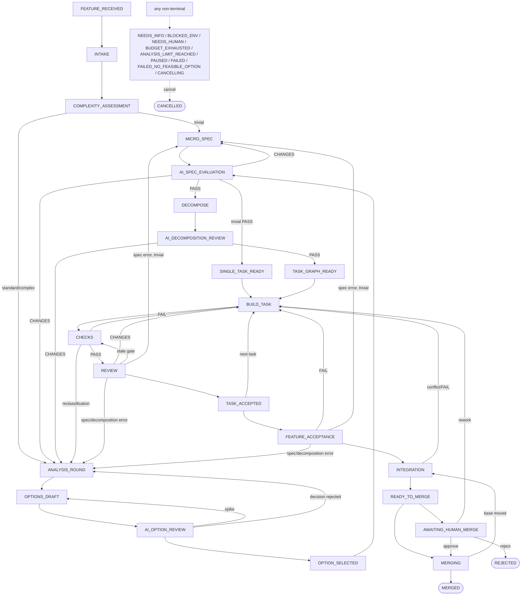

# Agent Factory architecture (implemented state)

This document describes what is in the code under `src/agent_factory/`, not the target blueprint. Deviations from
the blueprint are listed at the end.

## Components and responsibilities

| Component | Module | Responsible for | Does not |
|---|---|---|---|
| Controller | `controller.py` (`Controller`, `legal`, `_MAIN`) | transition legality, guard on the target state, CAS on the job version, `state.transition` event | does not read agent text; the guard reads only signed results |
| Orchestration | `factory.py` (`Factory`) | performing the work of a given state (`_step_<state>`), agent calls, error routing, checkpoints, halt/resume, cancel, human decisions | does not bypass guards; `resume` writes the state directly, but only after `legal()` (see state-machine.md) |
| Identity and invalidation | `identities.py` | `InputIdentity`, `digest` (SHA-256 of canonical JSON), `RESULT_DEPENDENCIES`, `stale_fields` | — |
| Evidence store | `evidence.py` (`EvidenceStore`) | content-addressed artifacts, HMAC-SHA256-signed results, findings lifecycle, `current_pass` | does not read exports from the job branch as evidence |
| Trusted runner | `runner.py` (`TrustedRunner`) | running commands from `factory/checks/default.yaml` in the sandbox, junit, `GateVerdict` classification, `CheckEvidence` | does not trust the builder's "tests passed" claim |
| Sandbox | `sandbox.py` | `MacSandbox` (SBPL for `sandbox-exec`), `BwrapSandbox`, probe at startup, env scrubbing | no mode without a sandbox |
| Policy | `policy.py` | gate on the actual diff (protected paths, file_scope, test weakening), risk and surfaces (`ui`, `security`), side-effect broker `authorize_side_effect` | does not lower risk |
| Scheduler | `scheduler.py` | DAG validation, `ready_tasks`, leases with epoch and fencing, global `agent_process` slots | no priorities/aging; tasks within a job run sequentially |
| Budget | `budgets.py` | reservation before every paid call, settlement from `total_cost_usd`, verification reserve, `raise_budget` | the agent does not raise the limit |
| Analysis counter | `analysis.py` | shared round counter (options + spec + decomposition), no-progress detection, `raise_limit` | does not reset on restart or model change |
| Decisions | `decisions.py` | option scoring with weights from `selection.yaml`, tie-break, exactly one choice, verification of the AI choice | — |
| Feature | `features.py` | input normalization, immutable snapshot and revisions, path classification `trivial/standard/complex` | — |
| Workspace | `workspaces.py` (`WorkspaceManager`) | worktree `factory/<job-id>` in `data_dir/worktrees`, controller commit, diff, integration candidate, conditional push, cleanup without `--force` | does not modify the user's checkout |
| Outbox | `outbox.py` | effect intent within a transaction, `pending/inflight/confirmed/unknown/failed`, `lookup` reconciliation before retry | does not promise exactly-once |
| Recovery | `recovery.py` | `recover_job`: results → git → processes → leases → outbox → budget | — |
| Claude runtime | `adapters/claude.py` (`ClaudeRuntime`) | `claude -p --output-format stream-json`, session, `--json-schema`, `--max-budget-usd`, polling from the event log, process group cancel | does not parse private transcripts |
| GitHub | `adapters/github.py` | `GitHubAdapter` (PR/comment/merge via outbox, idempotency marker), `LocalMergeHandler` (`local` mode), `StubGitHub` (tests) | `GitHubAdapter` is not wired into the CLI (see below) |
| Dashboard | `dashboard/__init__.py` | read-only SQLite projection, localhost, escaping, CSP | no state-changing actions |
| CLI | `cli.py` | `factory` command, exit codes 0/2/3/4, `--json` | — |
| Factory eval | `evals.py` (`run_suite`) | `full` vs `single-agent` profile on fresh fixture copies with a local bare remote; success is decided by golden tests added to a scratch copy of the final tree and run by `TrustedRunner` | pilot results: `acceptance-report.md` |

## Where state lives

The data directory is `data_dir` from `factory/config.yaml` (default `~/.local/share/agent-factory`;
a relative path is resolved from the parent directory of `factory/`; `--data-dir` overrides it).

| Path in `data_dir` | Contents |
|---|---|
| `state.db` (+ `-wal`, `-shm`) | SQLite in WAL mode, `busy_timeout=30000`, migrations in `schema_migrations` (currently version 2). The single source of truth for state |
| `artifacts/<aa>/<bb>/<sha256>` | SHA-256 content-addressed content: result payloads, stdout/stderr logs, checkpoints, rejected patches |
| `keys/evidence.key` | 32-byte HMAC key (file `0600`, directory `0700`) |
| `worktrees/<job-id>/` | the job's worktree on branch `factory/<job-id>` |
| `runs/<job-id>/run-<ns>/` | runner scratch: `home/`, `tmp/`, `stdout.log`, `stderr.log`, `report.xml` |
| `agent-logs/<run-id>.jsonl`, `.stderr` | `stream-json` stream and stderr of Claude CLI calls |
| `repos.json` | repo registry from `factory init` |
| `holdout/` | only blocked in the sandbox; the code neither creates nor reads it |
| `evals/<suite>-<profile>-<id>/` | `factory eval` runs: separate `state.db`, `data/`, logs and `report.json` per task |

SQLite tables: `features`, `jobs`, `tasks`, `attempts`, `leases`, `events`, `artifacts`, `results`,
`findings`, `approvals`, `outbox`, `usage`, `budget_reservations`, `resource_allocations`,
`complexity_assessments`, `analysis_rounds`, `schema_migrations` (`state.py`). The index
`jobs_one_active_per_scope` enforces one active job per `(repo_id, source_id, scope_revision)`.
The job context (`spec`, `plan`, digests, `current_task`, `candidate`, `merge_op`…) is JSON in
`jobs.context_json`, updated under CAS (`Store.update_job_context`).

Git is the source of truth for code. The controller commits the builder's work (`WorkspaceManager.commit_all`,
author `Agent Factory`, `--no-verify`) and exports the spec/plan to
`openspec/changes/<change-id>/` in the worktree (`Factory._write_spec_files`). Exports are for
reading only and are never read as evidence.

## Flow of a single job

1. `factory submit` → `features.normalize` → `store_feature` (revision) → `Factory.submit` creates
   a `jobs` row in `FEATURE_RECEIVED` with the round limit and budget from the configuration.
2. `factory run --job` → `Factory.run`: a `step()` loop until a terminal state, a halted state (`HALTED`)
   or `READY_TO_MERGE` with `merge.enabled: false`. At most 200 steps per call.
3. `INTAKE`: worktree from `origin/<base>` (`default_branch` never assumes `main`), agent
   `factory-intake`, records `environment_digest` (`checks_digest` is computed live from `factory/checks/` and `factory/skills/`).
4. `COMPLEXITY_ASSESSMENT`: agent `factory-classify-feature`, deterministic `features.classify`,
   result `classification`, path `trivial` → `MICRO_SPEC`, otherwise `ANALYSIS_ROUND`.
5. Analysis (rounds of the shared counter): options (`factory-options-review` in
   `draft-and-critique` mode in `OPTIONS_DRAFT`) → choice (`decisions.select` + `verify_ai_choice`) →
   spec → `factory-spec-evaluate` + structural controller checks → plan → DAG validation +
   `factory-decomposition-review`. The trivial path creates a single task `TASK-01`.
6. Before the first build: baseline checks on the untouched base (`baseline_ok`); FAIL → `BLOCKED_ENV`.
7. `BUILD_TASK` (agent `factory-implement`, writes to the worktree) → controller commit → `CHECKS`
   (policy gate on the builder's diff, risk from the whole job's diff, runner) → `REVIEW` (required reviews
   on the frozen HEAD; a stale `gate` result goes back to `CHECKS`; after the reviewers the worktree must be
   clean) → `TASK_ACCEPTED` → next ready task or `FEATURE_ACCEPTANCE`.
8. `FEATURE_ACCEPTANCE`: `acceptance` stage checks + `factory-product-verify` for the whole feature.
9. `INTEGRATION`: merge of the fresh base into the job branch (candidate), `integration` stage checks,
   `factory-integration-review`, result bound to `candidate_tree_sha`.
10. `READY_TO_MERGE` → (`AWAITING_HUMAN_MERGE` depending on `merge.human_interaction`) → `MERGING`:
    check that the base has not moved, outbox `local.merge` → `LocalMergeHandler` →
    `git push --force-with-lease=refs/heads/<base>:<tested-base-sha>` → `MERGED` → cleanup.

## Diagram of implemented states

The edges are `_MAIN` from `controller.py`. Side states are reachable from every non-terminal state
(the `legal()` rule); only typical entries are shown.

## Parallel tasks within a job (lane pool, `lanes.py`)

`execution.max_builders_per_job > 1` enables the pool: when the job is in `BUILD_TASK` and there are ≥ 2 ready tasks
with disjoint file scopes (`lanes.scopes_overlap`; test paths do not count, an empty scope =
conflict), the controller starts up to `max_builders_per_job` lanes. Each lane: a detached worktree
`worktrees/<job>--<task>` from the job's current head (lane agents do not see the job's worktree or other lanes),
its own builder, trusted checks and reviewers; results are signed with the lane head's identity.

A finished lane is integrated into the job's worktree right away (it does not wait for the others): acceptance
only if (1) the signed gate and required review results are current for the lane head and there are no open
blocking findings, (2) `git merge --no-ff` has no conflict, (3) when the tree differs from the lane's —
checks pass on the merged tree. The freed slot gets the next ready task (scope
disjoint from the running lanes), built on the newer head. A conflict or failure of the merged
checks → `REWORK` without consuming an attempt. CHANGES/FAIL → a regular `REWORK`. Ambiguous reviews
(UNKNOWN/BLOCKED ×3) → the lane is **parked** (`refs/factory/parked/<job>/<task>`, `parked_lanes`):
on the next start only the reviews are repeated, without a rebuild and without a new attempt; after
`MAX_PARKS` parkings the job waits in `NEEDS_HUMAN`, and `factory resume` gives the reviews another chance.
Budget/block in a lane → the attempt is refunded, new lanes do not start, running ones finish and are
integrated, then the job stops. Controller killed mid-run: `_recover_wave` stops the
lane agents, marks attempts `abandoned`, restores the tasks and removes the lanes.

## What is not implemented (relative to the blueprint)

- **OpenSpec archiving (§6.4, AF-36)**: missing. The controller does not call the `openspec` CLI at all
  (neither `validate` nor `archive`); `factory doctor` only checks that the binary is present.
- **`pr`/`automerge`/`release` modes in the CLI**: `cli.py::_make_factory` wires `LocalMergeHandler`
  only for `policy.mode == "local"`; in other modes the handler is `None`, so `MERGING` ends
  with `BLOCKED_ENV: no merge handler configured`. Orchestration does not create a PR (no
  `github.create_pr` step). `GitHubAdapter` is tested only against `StubGitHub`, not against real GitHub.
- **`factory submit --issue`**: unsupported (refused in `offline/local`, in other modes
  a message and a requirement for `--file/--text`).
- **Server-side merge queue**: not used. In `local` mode the atomic base check is
  `git push --force-with-lease=<base>:<expected>` in `WorkspaceManager.push_to_base`.
- **Release/deploy**: no release entity; `deploy` exists only in the broker (`policy.SIDE_EFFECTS`).
- **Parallelism across jobs**: `factory run` without `--job` processes jobs one by one; `max_active_jobs`,
  `max_test_processes`, `max_integration_candidates`, `command_timeout_seconds`, `job_deadline_minutes`
  are validated but unused. Enforced are the `agent_process` slot (`max_agent_processes`) and
  `max_builders_per_job` (lanes above).

- **Skills not called in orchestration**: `factory-repo-map` (the controller does `git ls-files`),
  `factory-test-design`, `factory-evidence-audit`, `factory-recover`, `factory-retrospective`,
  `factory-release-verify`. `factory/prompts/*.md` are not loaded by the code — the system prompt is
  `skills/_shared/contract.md` + `SKILL.md`.
- **Holdout (§7.9)**: only a deny rule for `data_dir/holdout`; no mechanism for private scenarios.
- **Ports**: `workspaces.allocate_port` exists but is not called.
